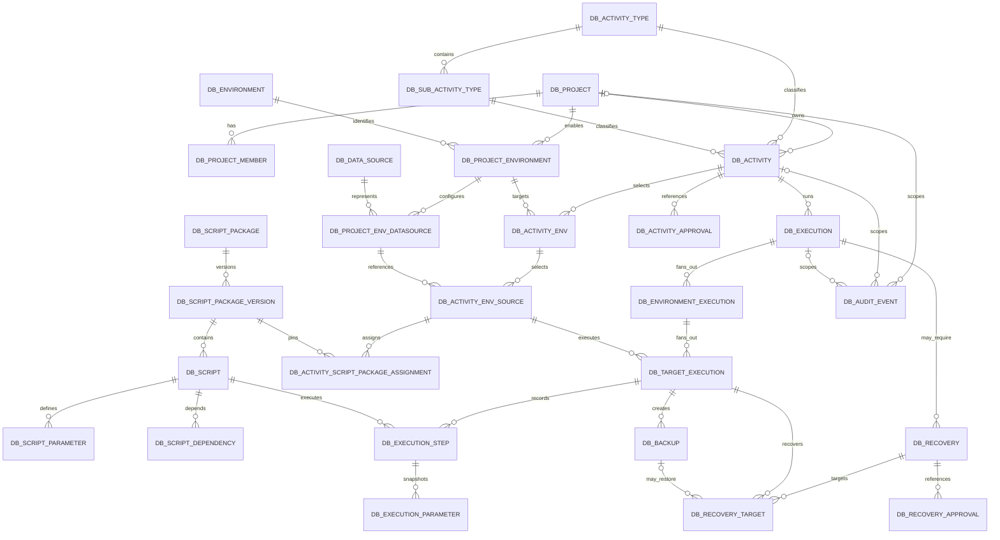

# Database Design

## 1. Purpose and database boundary

This document defines the relational model for the Database Operations module before
the next schema implementation begins.

The service has two different database roles:

1. **Metadata database**: stores projects, logical data sources, activity definitions,
   immutable script versions, approval references, execution state, backup metadata,
   recovery state, and audit events.
2. **Target databases**: the non-production Oracle or PostgreSQL databases on which
   approved operational scripts run.

Flyway migrations in this repository apply to the **metadata database only**. They must
not create Database Operations tables on every target database. A target database may
receive user-approved operational SQL, but it does not own the service's project,
activity, execution, or audit records.

PostgreSQL is the current metadata database. Oracle and PostgreSQL are supported target
engines. If Oracle metadata hosting is later required, maintain and test a separate
Oracle metadata migration set; do not assume one dialect's migrations are portable to
the other.

## 2. Design goals

- Normalize configuration and lifecycle records; avoid copying credentials into
  activities or executions.
- Reference a central logical data source while keeping each project's environment
  connection configuration distinct.
- Preserve the exact approved activity, script-package version, target mapping, and
  parameter snapshot used by each execution.
- Track status independently for activity, environment, target data source, script step,
  backup, and recovery.
- Keep large artifacts and execution logs out of relational rows.
- Enforce invariants using foreign keys, unique constraints, check constraints, and
  transactions.
- Support paging and time-bounded queries as records grow.
- Keep approval, identity, notification, and shared audit services as external system of
  record where the Assurance Portal already provides them.

## 3. Entity relationship overview



`DB_PROJECT_ENV_DATASOURCE` is the project/environment-specific connection mapping.
It references the reusable logical `DB_DATA_SOURCE` definition, but contains the
environment-specific endpoint and secret reference. That distinction allows `CORE_DB`
to be the same logical source in UAT and STAGE while each environment connects to a
different database host and credential.

## 4. Table catalog

The following is the logical table contract. Physical types must use the dialect mapping
in section 5.

### 4.1 Shared configuration

| Table | Purpose and key columns | Constraints |
|-------|-------------------------|-------------|
| `db_project` | `id`, `project_code`, `project_name`, `owner_name`, `status`, `promotion_mode`, `created_by`, timestamps, `row_version` | PK `id`; unique `project_code`; checked status and promotion mode |
| `db_project_member` | `id`, `project_id`, external `user_id`, `role_code`, `enabled`, `created_at`, `created_by` | FK project; unique `(project_id, user_id)`; roles are project-scoped, not a local identity store |
| `db_environment` | `code`, `name`, `description`, `sort_order`, `is_production`, `enabled` | PK code; seed UAT/STAGE/STAGE2/STAGE3; production targets excluded by policy |
| `db_project_environment` | `id`, `project_id`, `environment_code`, `enabled`, `promotion_order`, optional approval-policy reference, timestamps | FKs project/environment; unique `(project_id, environment_code)`; unique `(project_id, promotion_order)` when order is set |
| `db_data_source` | `id`, `DATA_SOURCE`, `data_source_name`, `engine`, description, enabled, timestamps, `row_version` | PK id; unique logical code; engine check ORACLE/POSTGRESQL |
| `db_project_env_datasource` | `id`, `project_environment_id`, `data_source_id`, `schema_name`, `jdbc_url`, `secret_ref`, `enabled`, timeout/pool policy reference, timestamps, `row_version` | FKs project environment and logical data source; unique `(project_environment_id, data_source_id)`; endpoint engine must match logical source |

`db_data_source` is a logical source definition; it must not contain a single universal
JDBC URL or credential if it is reused across different environments. The endpoint and
secret reference belong to `db_project_env_datasource`. A central secret provider owns
the actual credential values; metadata stores only the reference.

`secret_ref` is a relative path in the configured Vault KV v2 mount, not a credential.
The application reads `username` and `password` from the referenced secret only when
testing or opening the selected environment connection. Never store Vault tokens or
database credentials in these metadata tables.

### 4.2 Catalog and templates

| Table | Purpose and key columns | Constraints |
|-------|-------------------------|-------------|
| `db_activity_type` | `id`, unique `code`, `name`, description, enabled, risk class, timestamps | Stable catalog key; soft-disable instead of deleting used entries |
| `db_sub_activity_type` | `id`, `activity_type_id`, code, name, description, enabled, risk class | FK activity type; unique `(activity_type_id, code)` |
| `db_activity_template` | `id`, code, name, description, activity/subactivity references, enabled, owner, timestamps, `row_version` | Unique code; catalog FKs; templates are mutable only as drafts or versioned if approved |
| `db_activity_template_version` | `id`, template_id, version number, immutable configuration document, checksum, created_by, created_at | FK template; unique `(template_id, version_number)`; immutable after use |

Shared IAM owns users and global roles. Shared Approval Center owns approval policies and
decisions. Database Operations stores external references and operational snapshots,
not parallel copies of these systems of record.

### 4.3 Activity configuration

| Table | Purpose and key columns | Constraints |
|-------|-------------------------|-------------|
| `db_activity` | `id`, human-readable `activity_code`, `project_id`, activity/subactivity references, name, change reference, description, priority, status, execution mode, requested_by, timestamps, `row_version` | Unique activity code; FKs project/catalog; checked state and priority; optimistic concurrency |
| `db_activity_env` | `id`, activity_id, project_environment_id, execution order, status/policy snapshot | FKs activity and project environment; unique `(activity_id, project_environment_id)` |
| `db_activity_env_source` | `id`, activity_env_id, project_env_datasource_id, execution order, status, required flag | FKs activity environment and configured source; unique `(activity_env_id, project_env_datasource_id)` |
| `db_activity_env_source_dependency` | `source_id`, `depends_on_source_id` | Composite PK; both FKs to source selection; reject self-dependency and cycles in service validation |
| `db_activity_script_package` | `id`, package code, name, description, owner, timestamps | Unique package code |
| `db_activity_script_package_version` | `id`, package_id, version, status, checksum, created_by, created_at, validated_at | Unique `(package_id, version)`; immutable once approved or assigned |
| `db_activity_script` | `id`, package_version_id, script_code, name, script_type, SQL content or immutable object reference, content checksum, execution order, transaction mode, timeout, error policy, description | FK package version; unique `(package_version_id, script_code)`; checked script type and policy |
| `db_activity_script_parameter` | `id`, script_id, name, data_type, required, default expression/value, sensitive flag, description | FK script; unique `(script_id, name)`; never store runtime secrets as defaults |
| `db_activity_script_dependency` | `script_id`, `depends_on_script_id` | Composite PK; both FKs to script; reject self-dependency and cycles in validation |
| `db_activity_script_package_assignment` | `id`, activity_env_source_id, package_version_id, assignment_mode, assigned_by, assigned_at | FKs selected source and immutable package version; normally one active assignment per selected source |

The baseline stores bounded SQL script content directly in `TEXT` / `CLOB`, with an
immutable checksum. Enforce a request-size limit in the API (start with 1 MiB per
script), and never mutate a package version after approval. Backup files and execution
logs remain in controlled artifact storage, not in these script rows. Sensitive
execution parameter snapshots must be encrypted by the application; validate the
encryption metadata before insert.

### 4.4 Approval references

| Table | Purpose and key columns | Constraints |
|-------|-------------------------|-------------|
| `db_activity_approval` | `id`, activity_id, external approval request ID, approval status snapshot, requested_by, submitted_at, decided_at, approved activity checksum/config version, correlation ID | FK activity; unique external request ID; append history for resubmission |
| `db_recovery_approval` | `id`, recovery_id, external approval request ID, status snapshot, requested_by, submitted_at, decided_at, approved recovery checksum | FK recovery; unique external request ID |

Approval Center remains the authority for decisions and eligible approvers. These tables
preserve the exact reference and approved snapshot needed for execution/audit. A
requester must not approve their own activity.

### 4.5 Execution and audit

| Table | Purpose and key columns | Constraints |
|-------|-------------------------|-------------|
| `db_execution` | `id`, activity_id, attempt number, idempotency key, request/actor, status, execution mode, approved snapshot checksum, requested/started/ended timestamps, correlation ID | FK activity; unique idempotency key in its scope; new retry gets a new execution record |
| `db_environment_execution` | `id`, execution_id, activity_env_id, status, started/ended timestamps, sequence order | FKs execution and selected environment; unique `(execution_id, activity_env_id)` |
| `db_target_execution` | `id`, environment_execution_id, activity_env_source_id, status, worker/job reference, attempt, precheck outcome, started/ended timestamps, safe result summary | FKs environment execution and selected source; unique target per environment execution/attempt |
| `db_execution_step` | `id`, target_execution_id, script_id, step order, status, started/ended timestamps, duration, rows affected, error code, redacted error summary, result artifact key | FKs target execution/script; unique `(target_execution_id, step_order)` |
| `db_execution_parameter` | `id`, execution_step_id, parameter name/type, encrypted value or non-sensitive value, encryption key reference, checksum | FK step; unique `(execution_step_id, parameter_name)`; never log raw sensitive values |
| `db_execution_event` | `id`, target_execution_id, event type, event timestamp, correlation ID, bounded/redacted details | FK target execution; append-only; time-partition candidate |
| `db_audit_event` | `id`, event timestamp, actor type/id, event type, project/activity/execution references, correlation ID, before/after status, redacted metadata | Append-only; nullable FKs for system-level events; time-partition candidate |

Store large worker logs in controlled log/artifact storage and reference them from
execution records. Do not put unbounded logs, result sets, backup bytes, or raw customer
data in metadata tables.

### 4.6 Backup and recovery

| Table | Purpose and key columns | Constraints |
|-------|-------------------------|-------------|
| `db_backup` | `id`, target_execution_id, project/environment/source references, backup type, status, storage object key, size bytes, record count, SHA-256 checksum, created/verified/expiry timestamps, worker identity | FK target execution; unique object key; positive size; only verified, unexpired backups are restore candidates |
| `db_recovery` | `id`, originating execution_id, recovery code, status, reason, requested_by, validation result/checksum, external approval reference, requested/started/ended timestamps | FK execution; unique recovery code; explicit state transitions |
| `db_recovery_target` | `id`, recovery_id, target_execution_id, backup_id nullable, recovery package version nullable, recovery mode, status, result/checksum | FKs recovery, affected target execution, optional backup/package; require exactly the approved recovery method |

Backup contents live in encrypted, access-controlled NFS/object storage, not in the
metadata database. Metadata stores references, checksums, retention, and verification.
Recovery targets only failed/affected sources unless a DBA-approved recovery plan says
otherwise. Failure must not automatically trigger rollback.

## 5. Physical types for PostgreSQL and Oracle

Keep the same logical schema and constraints, but use dialect-specific Flyway migration
locations. The current project has PostgreSQL metadata and Oracle/PostgreSQL target
drivers; Oracle metadata migration support is a separate capability.

| Logical type | PostgreSQL metadata | Oracle metadata |
|--------------|---------------------|-----------------|
| Internal ID | `UUID` | `RAW(16)` (encode/decode in repository) |
| Human-readable code | `VARCHAR(n)` | `VARCHAR2(n CHAR)` |
| Boolean | `BOOLEAN` | `NUMBER(1)` plus `CHECK (column IN (0, 1))` |
| Instant | `TIMESTAMPTZ` | `TIMESTAMP(6) WITH TIME ZONE` |
| Large SQL/text | `TEXT` | `CLOB` |
| Large integer / byte count | `BIGINT` | `NUMBER(19)` |
| Small integer/order | `SMALLINT` / `INTEGER` | `NUMBER(5)` / `NUMBER(10)` |
| JSON policy details (bounded) | `JSONB` | `CLOB` with `IS JSON` constraint where supported |

Use native UUIDs for PostgreSQL and `RAW(16)` for Oracle if both dialects are maintained;
do not use random human-readable strings as primary keys. Generate opaque internal IDs
in the application and human-readable activity/execution codes using a dedicated
sequence/number allocation strategy. Do not infer identity from timestamps.

Recommended Flyway layout if Oracle metadata becomes a requirement:

```text
src/main/resources/db/migration/postgresql/
src/main/resources/db/migration/oracle/
```

Select one location set from explicit metadata database configuration. Never run both
sets against one database. Until Oracle metadata is an approved requirement, keep the
current PostgreSQL migration location as the only supported metadata schema.

## 6. Status and concurrency rules

Persist statuses as constrained strings or small reference codes, not database-specific
native enums. Validate transitions in the service layer and enforce valid values in
database check constraints.

Required independent state groups:

- Activity: `DRAFT`, `SUBMITTED`, `PENDING_APPROVAL`, `APPROVED`, `REJECTED`,
  `IN_PROGRESS`, `COMPLETED`, `PARTIALLY_COMPLETED`, `FAILED`, `CANCELLED`
- Environment execution: `PENDING`, `READY`, `BLOCKED`, `RUNNING`, `COMPLETED`,
  `FAILED`, `SKIPPED`
- Target execution: `PENDING`, `PRECHECK_RUNNING`, `PRECHECK_FAILED`, `BACKUP_RUNNING`,
  `BACKUP_COMPLETED`, `EXECUTING`, `VERIFYING`, `COMPLETED`, `FAILED`,
  `CANCEL_REQUESTED`, `CANCELLED`
- Script step: `PENDING`, `RUNNING`, `SUCCESS`, `FAILED`, `SKIPPED`
- Backup: `PENDING`, `RUNNING`, `COMPLETED`, `VERIFIED`, `FAILED`, `EXPIRED`
- Recovery: `DRAFT`, `PENDING_APPROVAL`, `APPROVED`, `RUNNING`, `VERIFYING`,
  `COMPLETED`, `FAILED`, `CANCELLED`

Use `row_version` optimistic locking on mutable aggregate roots such as project,
data-source configuration, activity, and script-package draft. Execution, audit, and
approval history are append-oriented; use explicit state-transition updates rather than
uncoordinated read/modify/write.

Queue claiming must be atomic, using a state transition/update with a condition or
database-specific `SKIP LOCKED` strategy. Do not hold a metadata transaction open during
long-running target SQL.

## 7. Indexing and growth strategy

### Baseline indexes

Create indexes for all foreign-key columns used in joins or deletes. At minimum:

- `db_project_member(project_id, enabled)`
- `db_project_environment(project_id, enabled, promotion_order)`
- `db_project_env_datasource(project_environment_id, enabled)`
- `db_project_env_datasource(data_source_id)`
- `db_activity(project_id, created_at DESC)`
- `db_activity(status, updated_at DESC)`
- `db_activity_env(activity_id, execution_order)`
- `db_activity_env_source(activity_env_id, execution_order)`
- `db_activity_script_package_assignment(activity_env_source_id)`
- `db_execution(activity_id, requested_at DESC)`
- `db_execution(status, requested_at)`
- `db_environment_execution(execution_id, status)`
- `db_target_execution(environment_execution_id, status)`
- `db_execution_step(target_execution_id, step_order)`
- `db_backup(target_execution_id, created_at DESC)`
- `db_backup(status, expires_at)`
- `db_recovery(originating_execution_id, created_at DESC)`

Use unique constraints to enforce identity and prevent duplicate assignment. Avoid
indexes on low-cardinality flags alone unless workload measurements show benefit.
Every additional index increases write cost and storage; validate query plans on
representative data.

### Partitioning and retention

Do not partition small configuration tables prematurely. As append-only execution and
audit history grows:

- Consider time-range partitioning for `db_audit_event`, `db_execution_event`, and
  possibly `db_execution_step`, based on observed volume and retention requirements.
- Use monthly partitions as a starting candidate, not a fixed mandate.
- Keep partition keys aligned with the most common time-filtered queries.
- Define retention/archive policy before deleting operational history.
- Maintain global identity and idempotency constraints carefully; some databases impose
  partition-key requirements on unique indexes.
- Keep backups in artifact storage with lifecycle expiration; never partition binary
  backup data into the metadata database.

Introduce partitioning only after load tests or production metrics show a need. Correct
indexes, bounded queries, pagination, and log/artifact separation deliver more value
early.

### Query practices

- Require pagination for list endpoints that can grow without bound.
- Use keyset pagination for large histories; offset pagination is acceptable for small
  catalogs and shallow pages.
- Select only response columns needed; avoid loading script content in activity lists.
- Fetch execution history by activity/source and a time window.
- Use bounded batches for cleanup and archival jobs.
- Do not use database-wide `COUNT(*)` for every dashboard refresh at high volume;
  introduce pre-aggregated summaries only after measuring query impact.

## 8. Migration compatibility

The current fresh-install schema and application model use `db_data_source` as the
reusable logical catalog (`code`, `name`, `engine`, description, enabled, creator).
`db_project_env_datasource` references it through `data_source_id`; environment-specific
URL, schema, and secret reference remain on the mapping. The API resolves the
logical source code and engine before inserting the mapping and joins the catalog when
reading mappings.

Migration `V2` removes the legacy `username` column from project/environment datasource
mappings; existing rows then obtain the username from their referenced Vault secret.
Before applying `V2` to an existing installation, populate each referenced KV v2 secret
with both its matching `username` and `password`, and verify the mapping's `secret_ref`
resolves correctly. Flyway cannot transfer usernames from SQL metadata into Vault; the
legacy column is dropped by `V2`.

Do not replace or edit migrations that have already been applied in a deployed database.
If an installation has the earlier disconnected V1/V2 layout, preserve its migration
history and create a forward-only migration to add/backfill `data_source_id`, validate
the backfill, add the foreign key, and then remove duplicated mapping columns. Use an
expand/backfill/contract deployment when application availability is required. Validate
the migration both from an empty database and from the actual deployed migration version.

The data-source code may be global if it represents a reusable logical database role
(for example, `CORE_DB`). If separate teams need different logical meanings for the
same code, add a namespace/owner and use unique `(namespace, DATA_SOURCE)` instead.
Do not make code unique by environment unless the domain intends separate logical source
identities.

## 9. Table creation ownership

| Database | Tables created by this service |
|----------|--------------------------------|
| PostgreSQL metadata | All `db_*` service metadata tables via the PostgreSQL Flyway migrations |
| Oracle target | No service metadata tables; only approved user scripts or native backup/recovery operations |
| PostgreSQL target | No service metadata tables; only approved user scripts or backup/recovery operations |

The worker selects a target by `(project, environment, data source)` and resolves its
registered connection. It must not run metadata Flyway migrations against targets.

## 10. Decision checklist before implementation

- Confirm PostgreSQL is the only supported metadata engine for the first complete schema.
- Confirm target Oracle and PostgreSQL instances never receive Database Operations
  metadata tables.
- Confirm whether data-source codes are globally reusable logical identifiers.
- Confirm secret-provider reference format and credential-rotation approach.
- Confirm activity/audit retention and backup artifact retention requirements.
- Confirm whether execution parameters can contain sensitive values and the encryption
  provider for snapshots.
- Confirm approval and audit system identifiers/correlation contract with the shared
  portal teams.
- Confirm online migration/deployment constraints before writing the V3 migration.

After these decisions, implement the model in versioned migrations and test it against
real PostgreSQL; add Oracle metadata DDL only if Oracle is explicitly selected as a
metadata deployment target.

## 11. Baseline create-table scripts

The repository includes executable fresh-install baseline scripts:

- `database/schema/postgresql/001_database_operations_schema.sql`
- `database/schema/oracle/001_database_operations_schema.sql`

Both create the logical model in this document with dialect-specific types and seed the
four supported non-production environments. Run exactly one script against a dedicated
Database Operations **metadata database**. These scripts do not install metadata tables
on registered operational targets.

Example execution:

```powershell
# PostgreSQL: connect as the dedicated metadata schema owner.
psql -h <host> -p <port> -U <metadata_user> -d <metadata_database> `
  -v ON_ERROR_STOP=1 `
  -f database/schema/postgresql/001_database_operations_schema.sql
```

```text
-- Oracle SQL*Plus / SQLcl: connect as the dedicated metadata schema owner,
-- then run:
@database/schema/oracle/001_database_operations_schema.sql
```

Use a migration/deployment account with only the required schema privileges. Supply
credentials through a protected prompt or approved secret mechanism; do not put real
passwords in shell history or committed scripts.

These are baseline/bootstrap scripts, not replacements for the current Flyway history.
Do not run either on a database already migrated through V1/V2: table names overlap, and
the current V1/V2 schemas need an explicit data-preserving migration. In deployments,
Flyway should own the selected metadata schema and a fresh-install baseline must be
represented by the corresponding versioned migration set. Validate each script against
the exact PostgreSQL or Oracle version used by the deployment before promoting it.
